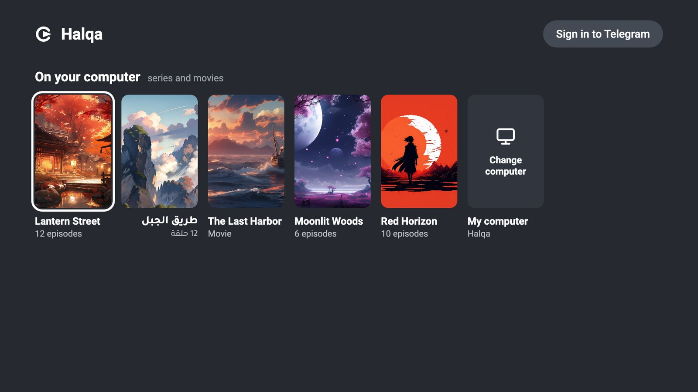
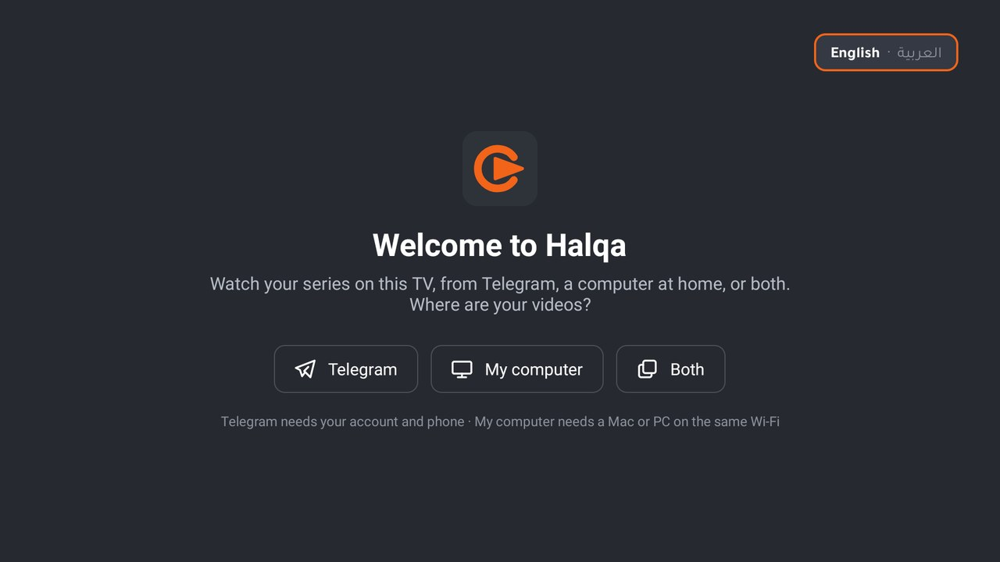
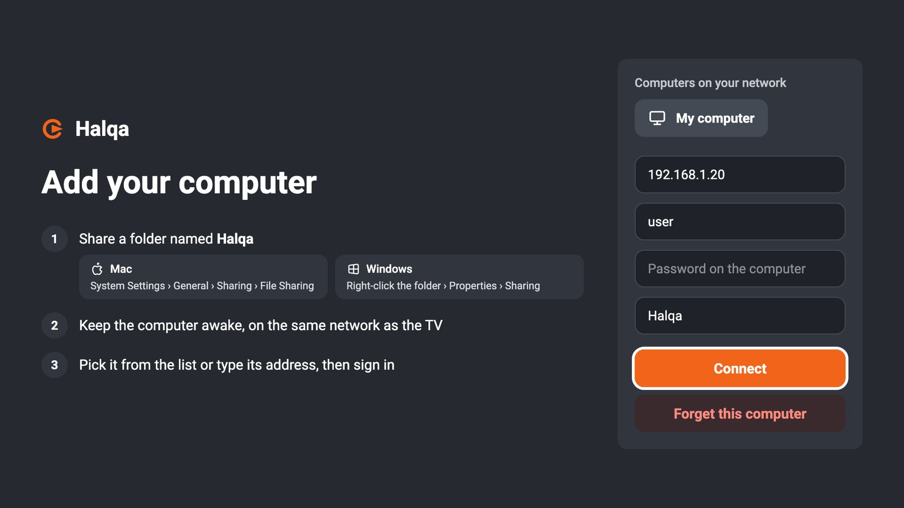
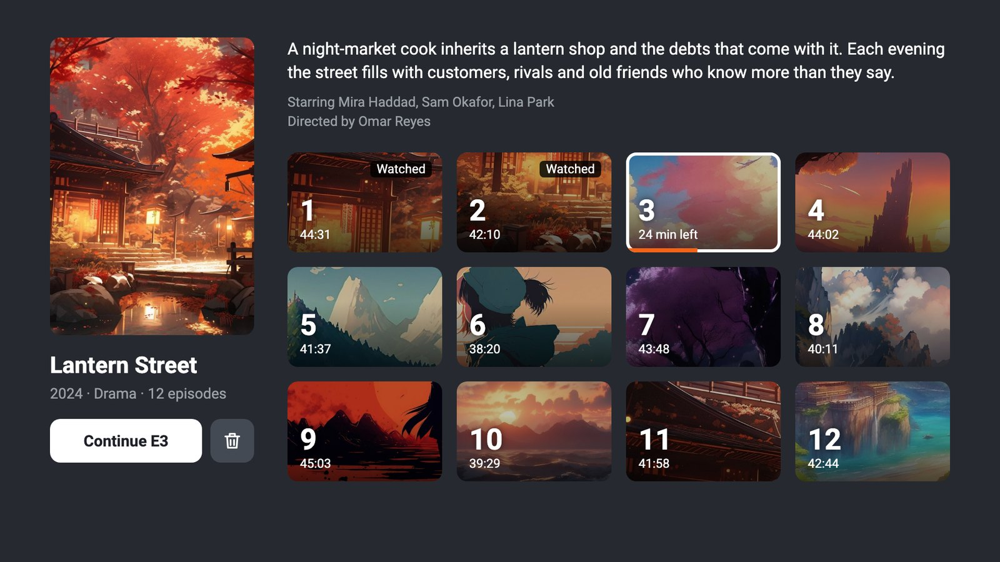
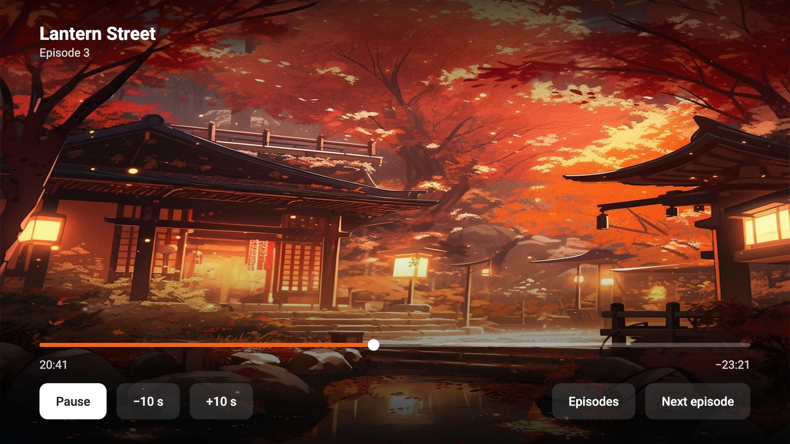

<p align="center">
  
</p>

<h1 align="center">Halqa</h1>

<p align="center">
  An Android TV app for watching series from your Telegram channels or a computer on your home network.
</p>

<p align="center">
  
</p>

Halqa groups your videos into series and episodes, like a streaming app: open a series, pick an episode and it
plays in Halqa's own player. Videos can come from Telegram, from a shared folder on a Mac or Windows PC, or both.
Telegram is optional.

Halqa is based on [Tele](https://github.com/saieshshirodkar/Tele) by Syndicate, released under the MIT licence.

## Screens

### Set up on first launch

A short guide asks where your videos are: **Telegram**, **My computer** or **Both**, then walks through each step
with a progress bar. For Telegram it shows how to get your own API key on my.telegram.org, lets you type the key
with the remote or paste it from your phone (scan the code on the TV), then signs you in with a QR code. For a
computer it lists what you need, how to share the folder on a Mac or Windows, and connects. The guide is in English
and Arabic; switch with the button in the top corner.



### Add your computer

Share a folder named `Halqa` on your Mac or Windows PC, keep the computer awake on the same network as the TV, then
pick it from the list (or type its address) and sign in with your user name and password on that computer.



### Series page

Each folder becomes a series with its poster, details and one tile per episode. Watched episodes are marked, and
**Continue** picks up where you stopped. The trash button deletes a series from the computer after you confirm.



### Player

A built-in player with a seek bar, ±10 seconds, an episode list and **Next episode**. Playback position is saved,
so you can stop and come back later.



<sub>Apart from the welcome screen, the screens above are mock-ups with made-up titles; the artwork is from Pixabay.</sub>

## What it does

- **Series, not a flat list.** Telegram videos are grouped by the series name and episode number found in their
  captions (Arabic, English and Turkish formats such as `الحلقة 35`, `Episode 5`, `S01E05` and `35. Bölüm`).
  Computer videos are grouped by folder, with episode numbers read from file names.
- **One tile per episode.** When a channel posts the same episode once per quality, those uploads become one episode,
  and OK opens a quality picker (4K, 1080p, 720p, …).
- **Trailers and clips left out.** Promos, teasers and short clips without an episode number are hidden.
- **Videos from your computer.** Halqa reads a shared folder over SMB, the standard file-sharing protocol on macOS
  and Windows. Macs on the network show up on their own; a Windows PC is added by typing its address.
- **Arabic titles.** A series with an Arabic title gets a right-to-left page, Arabic labels and an Arabic font.
- **Built-in player.** Videos from Telegram and from your computer play in the app; no other player is needed.

## Organising the shared folder

```
Halqa/
├── Lantern Street/
│   ├── poster.jpg
│   ├── info.json
│   ├── Lantern Street E01.mp4
│   └── Lantern Street E02.mp4
└── The Last Harbor.mp4
```

- A folder is a series; each video in it is an episode. A video lying loose in `Halqa/` is a movie.
- The poster is the image named in `info.json`, otherwise one whose name starts with `poster`, `cover` or `folder`,
  otherwise the largest image in the folder (`.jpg`, `.png` or `.webp`).
- Episode numbers come from names like `S01E05`, `E05`, `Episode 5` or `الحلقة 5`.
- `info.json` is optional and adds details to the series page:
  ```json
  {
    "title": "Lantern Street",
    "year": 2024,
    "genres": ["Drama"],
    "network": "Example TV",
    "country": "Japan",
    "director": "Omar Reyes",
    "cast": ["Mira Haddad", "Sam Okafor"],
    "summary": "A night-market cook inherits a lantern shop.",
    "poster": "poster.jpg"
  }
  ```

## What you need

- An Android TV device. The build targets 32-bit ARM (`armeabi-v7a`), which runs on both 32-bit and most 64-bit TVs.
- For Telegram: a Telegram account, and your own API ID and API hash from
  [my.telegram.org/apps](https://my.telegram.org/apps). Keep them private.
- For your computer: a Mac or Windows PC on the same network as the TV, with a shared folder named `Halqa`.
  On a Mac, turn on File Sharing in System Settings › General › Sharing, and under Options tick your user for
  Windows File Sharing.

## Building it

1. Clone this repository.
2. Create `local.properties` in the project root with your Telegram API keys. This file is git-ignored, so your keys
   stay on your machine:
   ```
   TELEGRAM_API_ID=your_api_id
   TELEGRAM_API_HASH=your_api_hash
   ```
   You can leave the keys out; the setup guide then asks for them on first launch and stores them on the TV.
   Build without keys when you share the APK with others, so each person uses their own.
3. Build with JDK 17 and install:
   ```
   ./gradlew :app:assembleDebug
   adb install -r app/build/outputs/apk/debug/app-debug.apk
   ```

A release build also needs `RELEASE_STORE_FILE`, `RELEASE_STORE_PASSWORD`, `RELEASE_KEY_ALIAS` and
`RELEASE_KEY_PASSWORD` in `local.properties`.

Don't share an APK built with your keys in `local.properties`: the keys are compiled into it.

## How it's built

- Kotlin, Android TV Leanback grids and Glide
- [TDLib](https://github.com/tdlib/td), Telegram's official client library
- [Media3 ExoPlayer](https://developer.android.com/media/media3/exoplayer) for playback
- [smbj](https://github.com/hierynomus/smbj) for reading the computer's shared folder
- Coroutines and Flow
- ZXing for the sign-in QR code

## Licence

MIT. See [LICENSE](LICENSE).
